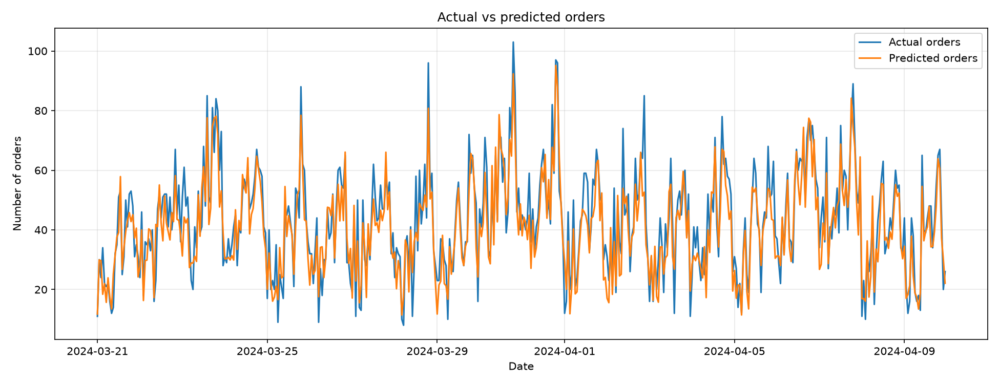
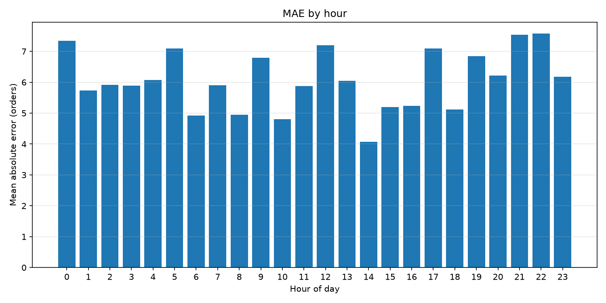
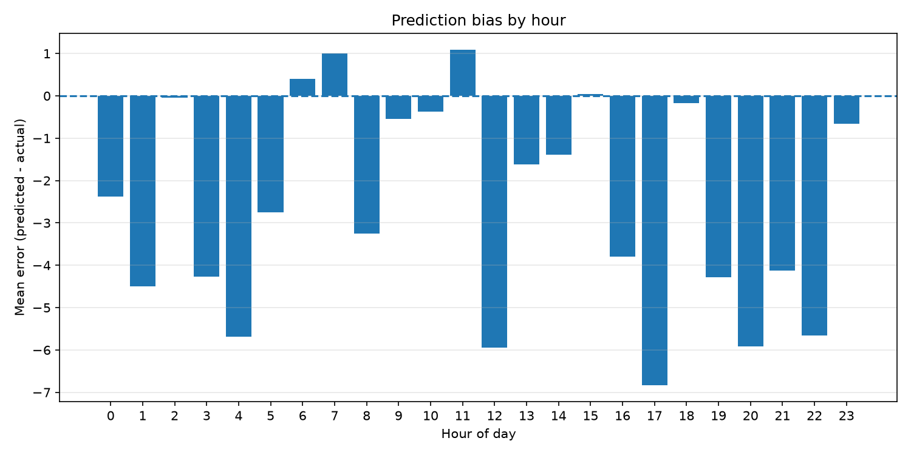

# Food Demand Forecasting

A machine learning project for forecasting food order demand using temporal, promotional, weather, and geographic features. The project covers the end-to-end ML workflow, from reproducible data generation and feature engineering to model evaluation, error analysis, and API deployment.

> **Data transparency:** This project uses a synthetic dataset generated specifically for demonstrating the machine learning workflow. It does not contain real iFood, restaurant, or customer data. All reported results are based on this synthetic dataset and should not be interpreted as real-world business performance.

## Project Overview

Accurate demand forecasting can help food delivery operations anticipate order volume and make better operational decisions.

This project explores how machine learning models can estimate the number of food orders based on:

- Hour of the day
- Day of the week
- Promotional activity
- Weather conditions
- Geographic zone

The solution includes model comparison, hyperparameter optimization, time-aware validation, error analysis, and a REST API for inference.

## Key Features

- Reproducible synthetic dataset generation
- Feature engineering for temporal and interaction patterns
- Chronological train/test split
- Time-series cross-validation
- Baseline comparison and multiple ML models
- Hyperparameter optimization with GridSearchCV
- Model persistence using Joblib
- Prediction error analysis by hour, weekday, and geographic zone
- REST API built with FastAPI
- Docker containerization
- Automated tests with Pytest

## Tech Stack

| Category | Technologies |
|---|---|
| Language | Python 3.13 |
| Data processing | Pandas, NumPy |
| Machine learning | Scikit-learn |
| Model persistence | Joblib |
| API | FastAPI, Uvicorn |
| Testing | Pytest |
| Visualization | Matplotlib |
| Containerization | Docker |

## Model Evaluation

The models were evaluated using a chronological 80/20 train/test split, with 1,920 training observations and 480 test observations.

TimeSeriesSplit with 3 folds was used for cross-validation.

### Test set results

| Model | MAE | RMSE | R² |
|---|---:|---:|---:|
| Baseline | 13.664 | 17.242 | -0.013 |
| Linear Regression | 7.171 | 9.057 | 0.720 |
| Random Forest | 6.371 | 8.016 | 0.781 |
| Gradient Boosting | 6.070 | 7.641 | 0.801 |
| Tuned Gradient Boosting | **6.068** | **7.641** | **0.801** |

**Selected model:** Tuned Gradient Boosting.

The hyperparameter search evaluated 36 parameter combinations. The selected configuration was:

- `learning_rate`: 0.08
- `max_depth`: 2
- `min_samples_leaf`: 2
- `n_estimators`: 200

The selected model achieved a cross-validation MAE of 5.910 ± 0.155.

The test MAE represents an improvement of approximately **55.59% over the baseline**.

### Error Analysis

The overall test-set bias was -2.567, indicating a tendency to underestimate demand.

Additional findings:

- Highest MAE by hour: 22:00 (7.572)
- Lowest MAE by hour: 14:00 (4.076)
- The North zone had the largest negative bias (-3.003).

These findings highlight the importance of analyzing prediction errors beyond aggregate performance metrics.

### Evaluation Visualizations

**Actual vs. Predicted**



**MAE by Hour**



**Prediction Bias by Hour**



## Project Structure

```text
food-demand-forecasting/
├── artifacts/
│   ├── demand_model.joblib
│   ├── metrics.json
│   └── predictions.csv
├── data/
│   └── food_orders.csv
├── reports/
│   ├── analysis/
│   │   ├── errors_by_hour.csv
│   │   ├── errors_by_weekday.csv
│   │   ├── errors_by_zone.csv
│   │   └── feature_importance.csv
│   ├── experiments/
│   │   ├── metrics_v3.json
│   │   └── metrics_v4.json
│   └── figures/
│       ├── actual_vs_predicted.png
│       ├── bias_by_hour.png
│       └── mae_by_hour.png
├── src/
│   ├── analyze_errors.py
│   ├── api.py
│   ├── features.py
│   ├── generate_data.py
│   ├── predict.py
│   └── train.py
├── tests/
│   ├── test_api.py
│   └── test_features.py
├── .dockerignore
├── .gitignore
├── Dockerfile
└── requirements.txt
```

## Getting Started

### Prerequisites

- Python 3.13+
- pip
- Docker (optional, for containerized execution)

### Installation

Clone the repository:

```bash
git clone https://github.com/YOUR_USERNAME/food-demand-forecasting.git
cd food-demand-forecasting
```

Create and activate a virtual environment.

**Windows PowerShell:**

```powershell
python -m venv .venv
.\.venv\Scripts\Activate.ps1
```

**Linux / macOS:**

```bash
python -m venv .venv
source .venv/bin/activate
```

Install dependencies:

```bash
pip install -r requirements.txt
```

### Generate Data and Train the Model

Generate the synthetic dataset:

```bash
python -m src.generate_data
```

Train and evaluate the models:

```bash
python -m src.train
```

The training pipeline saves the selected model and evaluation artifacts in the `artifacts/` directory.

### Run a Prediction

```bash
python -m src.predict --hour 19 --weekday 5 --promotion 1 --weather rain --zone central
```

### Run Error Analysis

```bash
python -m src.analyze_errors
```

The analysis generates CSV reports and visualizations in the `reports/` directory.

## REST API

The project exposes a prediction API built with FastAPI.

Start the API locally:

```bash
uvicorn src.api:app --reload
```

The API will be available at:

`http://127.0.0.1:8000`

Interactive API documentation:

`http://127.0.0.1:8000/docs`

### Prediction Endpoint

`POST /predict`

Example request:

```json
{
  "hour": 19,
  "weekday": 5,
  "promotion": 1,
  "weather": "rain",
  "zone": "central"
}
```

Example response:

```json
{
  "predicted_orders": 86.94,
  "unit": "orders"
}
```

The prediction value is illustrative and depends on the trained model artifact.

## Docker

Build the Docker image:

```bash
docker build -t food-demand-api .
```

Run the container:

```bash
docker run -d -p 8000:8000 --name food-demand-container food-demand-api
```

Access the API documentation:

`http://localhost:8000/docs`

To stop the container:

```bash
docker stop food-demand-container
```

## Testing

Run the automated test suite:

```bash
python -m pytest -v
```

The tests cover API health checks, prediction behavior, input validation, and feature generation.

## Limitations

- The dataset is synthetic and does not represent real restaurant demand.
- Model performance may differ significantly on real-world data.
- The model tends to underestimate demand in the evaluated test period.
- The final test set has been used in iterative model comparisons, so its metrics should not be treated as a completely untouched estimate of generalization performance.
- Weather and geographic categories must be consistent with the training data.

## Future Improvements

- Evaluate the model on a real, properly licensed demand dataset.
- Introduce a completely untouched final holdout period.
- Expand rolling-origin validation experiments.
- Investigate additional forecasting models.
- Add prediction intervals and uncertainty estimation.
- Implement model monitoring and data drift detection.
- Add CI automation with GitHub Actions.

## License

This project is intended for educational and portfolio purposes. A formal license can be added when the repository is published.